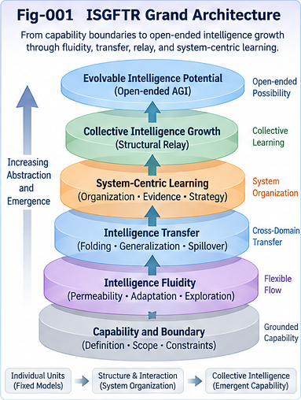

# Intelligence Spillover, Generalization, Fluidity, Transfer, and Relay (ISGFTR)

**An open, theory-first research program on capability frontiers, structural transfer, system-centric learning, and evidence-bearing intelligence relay.**

**Version:** v1.0.0 (research framework)  
**Status:** Open hypotheses, proposed contracts, and illustrative study designs — **not** an experimentally validated AGI system  
**Date:** 2026-10-31  
**License:** Apache-2.0 (subject to the repository's `LICENSE.txt` file)

> **Central question:** How can capabilities appear beyond their initially observed task boundaries, and under what conditions can systems discover, test, transfer, preserve, and collectively improve those capabilities?

ISGFTR explores five related but distinguishable characteristics of intelligence: **spillover**, **generalization**, **fluidity**, **transfer**, and **relay**. The project examines their possible interactions with structural folding/unfolding, weak-evidence prospecting, selective permeability, multi-level learning, and recursive structural adaptation. It proposes explicit research contracts and controlled experiments so that promising ideas can be tested, contested, and revised rather than accepted on the strength of analogy or terminology.

**This repository is a research invitation, not a declaration that AGI has been achieved or that intelligence growth is unbounded.**

---



*Fig-001. Conceptual ISGFTR architecture connecting capability prospecting, controlled experiments, evidence adjudication, structural relay, and research governance. Feedback arrows denote research opportunities, not guaranteed intelligence growth.*

---

## 1. The five characteristics

| Characteristic | Working meaning | What it does **not** establish |
| --- | --- | --- |
| **Spillover** | Useful capability appears outside the task or domain where it was originally identified or trained. | That the capability was absent before, or that it generalizes universally. |
| **Generalization** | A learned or represented structure remains useful under relevant changes of context or task. | That compression or abstraction alone guarantees robust transfer. |
| **Fluidity** | A system can adaptively redirect intelligence across tasks, representations, components, and boundaries. | That every boundary should be open or that movement produces benefit. |
| **Transfer** | Knowledge, structure, strategy, or evidence from one setting contributes to performance or inquiry in another. | That superficial similarity implies structural equivalence. |
| **Relay** | Capabilities, evidence, structural units, and unresolved questions are handed across agents, systems, or time. | That transmission equals correct adoption, utility, or durable growth. |

These are **analytical lenses**, not five proven independent laws. A single observation may involve several characteristics, and different explanations must be evaluated against controls.

## 2. Research thesis and boundaries

A model's original training objective, a benchmark score, or a currently available toolchain may provide an incomplete account of its *possible* behavior. Yet the gap between observed and potential behavior is a **research question**, not evidence of unlimited latent competence.

ISGFTR distinguishes four boundary questions:

1. **Generative boundary:** What can a given model or component produce under specified conditions?
2. **Observed boundary:** What has been demonstrated with adequate evidence and evaluation?
3. **Reachable boundary:** What could the current system organization, tools, and resources plausibly accomplish?
4. **Evolvable boundary:** What might become reachable after future changes to learning, structure, or organization?

These boundaries depend on task, resources, environment, evaluator, and time. They are **not assumed to be universally nested geometric regions**; evidence may revise each independently.

### Working research cycle

```text
Capability profiles + known limits + historical evidence
                         |
                         v
              Prospect possible spillover
                         |
           Weak evidence / structural analogy
                         |
                         v
               Gate A: Admit a probe?
                         |
                  Bounded experiment
                         |
                         v
             Evaluate against baselines
                         |
             Gate B: Support a claim?
                         |
                         v
         Preserve evidence, counterevidence,
            residuals, provenance, limits
                         |
                         v
          Structural relay / collective learning
                         |
                         +----> New questions and prospects
```

**Gate A** is permission to investigate; **Gate B** concerns the evidence for a *scoped capability claim*. Neither grants automatic deployment authority.

## 3. Distinctive research directions

### 3.1 Folding, generalization, and structural reuse

A shared structural core may be extracted from different tasks and reused through controlled unfolding. Domain-specific residuals must remain explicit: abstraction can discard decisive constraints. The project investigates both uncertainty preserved during folding and uncertainty recovered later through probing and evaluation. See [ISGFTR-003](docs/ISGFTR-003-Folding-Generalization-Duality-and-Structural-Reuse.md).

### 3.2 Directional intuition and weak-evidence transfer

Historical precedents, partial structural correspondence, perspective-dependent metrics, and unmatched **OTHERS** residuals may guide exploration without constituting proof. A prospecting score ranks research opportunities; it is **not** a calibrated probability of success unless independently calibrated. See [ISGFTR-005](docs/ISGFTR-005-Directional-Intuition-and-Weak-Evidence-Transfer.md) and [ISGFTR-008](docs/ISGFTR-008-Intelligence-Spillover-and-Transfer-Prospecting.md).

### 3.3 Selective permeability

Intelligence fluidity requires boundaries that may be selectively opened for observation or controlled experimentation while remaining closed for unsupported adoption or deployment. An adaptive boundary policy should itself be evaluated for robustness, safety, cost, and negative transfer. See [ISGFTR-004](docs/ISGFTR-004-Intelligence-Fluidity-and-Permeable-Structural-Boundaries.md) and [EXT-002](extensions/EXT-002-Learning-the-Boundaries-of-Intelligence-Flow.md).

### 3.4 System-centric learning and frozen execution units

Some persistent improvement may arise from changes in task decomposition, routing, shared memory, verification, and organizational structure **without updating the parameters of execution models**. This is a testable claim about *system-level* learning, not evidence that the underlying model has learned or that a system has achieved AGI. See [ISGFTR-006](docs/ISGFTR-006-System-Centric-Intelligence-and-Multi-Level-Learning.md) and [CASE-002](cases/CASE-002-Minimal-System-Centric-Collective-Learning.md).

### 3.5 Recursive relay and collective intelligence

Relay may occur across subjects (**spatial relay**) or repeated runs (**temporal relay**). Even unsuccessful or repeated executions can generate valuable evidence if results are recorded, compared, and used to update future decisions. However:

> **Mobility ≠ Utility ≠ Durable Growth.**  
> **Recursive Relay ≠ automatically Recursive Self-Improvement.**

See [ISGFTR-007](docs/ISGFTR-007-Recursive-Relay-and-Open-System-Intelligence-Growth.md) and [SPEC-004](specs/SPEC-004-Structural-Relay-and-Collective-Learning-Contract.md).

## 4. Repository map

The repository is organized into **20 substantive research documents**: 10 theoretical papers, 4 proposed specifications, 3 illustrative cases, and 3 exploratory extensions. Supporting navigation, validation, figure, and publication assets are tracked separately.

### Core papers — `docs/`

| Paper | Focus |
| --- | --- |
| [ISGFTR-001](docs/ISGFTR-001-From-Static-Intelligence-Boundaries-to-Open-Capability-Frontiers.md) | Static intelligence boundaries and open capability frontiers |
| [ISGFTR-002](docs/ISGFTR-002-Five-Characteristics-of-Intelligence-Spillover-and-Relay.md) | Five characteristics of intelligence flow |
| [ISGFTR-003](docs/ISGFTR-003-Folding-Generalization-Duality-and-Structural-Reuse.md) | Folding–generalization duality and structural reuse |
| [ISGFTR-004](docs/ISGFTR-004-Intelligence-Fluidity-and-Permeable-Structural-Boundaries.md) | Fluidity and permeable boundaries |
| [ISGFTR-005](docs/ISGFTR-005-Directional-Intuition-and-Weak-Evidence-Transfer.md) | Directional intuition and weak-evidence transfer |
| [ISGFTR-006](docs/ISGFTR-006-System-Centric-Intelligence-and-Multi-Level-Learning.md) | System-centric and multi-level learning |
| [ISGFTR-007](docs/ISGFTR-007-Recursive-Relay-and-Open-System-Intelligence-Growth.md) | Recursive relay and open-system growth |
| [ISGFTR-008](docs/ISGFTR-008-Intelligence-Spillover-and-Transfer-Prospecting.md) | Capability prospecting and frontier discovery |
| [ISGFTR-009](docs/ISGFTR-009-AGI-Implications-Limits-and-Counterarguments.md) | AGI implications, limits, and counterarguments |
| [ISGFTR-010](docs/ISGFTR-010-An-Open-Research-Architecture-for-Collective-Learning.md) | Integrated open research architecture |

### Proposed contracts — `specs/`

| Specification | Purpose |
| --- | --- |
| [SPEC-001](specs/SPEC-001-Canonical-Capability-and-Boundary-Contract.md) | Capability identity, scoped boundaries, claims, and provenance |
| [SPEC-002](specs/SPEC-002-Spillover-Opportunity-and-Evidence-Contract.md) | Opportunity, weak evidence, residuals, and counterevidence |
| [SPEC-003](specs/SPEC-003-Prospecting-Probing-and-Validation-Lifecycle.md) | Probe lifecycle, authorization, gates, and validation |
| [SPEC-004](specs/SPEC-004-Structural-Relay-and-Collective-Learning-Contract.md) | Portable relay units, evidence lineage, and collective learning |

Specifications are **proposed research contracts**, not implemented or independently certified interoperability standards.

### Illustrative cases — `cases/`

| Case | Research design |
| --- | --- |
| [CASE-001](cases/CASE-001-LLM-Capability-Spillover-and-Cross-Domain-Transfer.md) | LLM cross-domain structural transfer and controlled baselines |
| [CASE-002](cases/CASE-002-Minimal-System-Centric-Collective-Learning.md) | Frozen-unit, multi-agent structural learning |
| [CASE-003](cases/CASE-003-Weak-Evidence-Capability-Prospecting-and-Relay.md) | Weak-evidence prospecting, probing, and relay |

The cases are **study designs and illustrative records**, not claims that the proposed experimental results have been obtained.

### Research extensions — `extensions/`

| Extension | Question |
| --- | --- |
| [EXT-001](extensions/EXT-001-Biomimetic-Fluidity-and-Selective-Permeability.md) | What can biological adaptive behavior suggest about selective permeability? |
| [EXT-002](extensions/EXT-002-Learning-the-Boundaries-of-Intelligence-Flow.md) | Can systems learn when and where intelligence should flow? |
| [EXT-003](extensions/EXT-003-Evolvable-Intelligence-Potential-and-Open-Ended-AGI.md) | What would count as durable, open-ended capability growth? |

### Supporting materials

- `START-HERE.md` — recommended reading paths for different audiences.
- `CONTENTS.md` — complete document directory.
- `GLOSSARY.md` — shared terms and disambiguation.
- `FIGURE-INDEX.md` and `figures/` — eight research figures.
- `OPEN-QUESTIONS.md`, `TESTABLE-HYPOTHESES.md`, `VALIDATION-ROADMAP.md` — explicit research and falsification agenda.
- `FUTURE-DIRECTIONS.md` — possible follow-on work.
- `CHANGELOG.md`, `CITATION.cff`, `.zenodo.json`, `LICENSE.txt` — publication and repository metadata.
- `release/` — GitHub release notes and ResearchGate publication materials.

**Asset note:** This README describes the intended repository layout. A linked supporting file or individual figure is available only once it has been added to the published repository; the list is not an assertion that every asset has already been committed.

## 5. Eight-figure visual guide

The proposed figure set is:

1. `Fig-001-ISGFTR-Grand-Architecture.png`
2. `Fig-002-Four-Intelligence-Boundaries.png`
3. `Fig-003-Five-Characteristics-of-Intelligence-Flow.png`
4. `Fig-004-Folding-Generalization-and-Structural-Transfer.png`
5. `Fig-005-Directional-Intuition-and-Selective-Permeability.png`
6. `Fig-006-System-Centric-Multi-Level-Learning.png`
7. `Fig-007-Spillover-Prospecting-and-Capability-Frontiers.png`
8. `Fig-008-Recursive-Relay-and-Collective-Intelligence-Growth.png`

Figure placement and individual image-file availability should be checked against `FIGURE-INDEX.md` during release preparation.

## 6. Validation philosophy

The project favors **specifications and conformance before runtime claims**. Proposed experiments should use preregistered tasks and metrics where practicable, comparable compute/tool budgets, frozen-model baselines, random or simple-heuristic controls, ablations, held-out domains, independent replication, and explicit negative-result reporting.

At minimum, a capability or transfer claim should specify:

- **Subject and scope:** model/system, task, domain, environment, resources, and permissions.
- **Mechanism hypothesis:** proposed shared core, adaptation, and domain-specific residuals.
- **Evidence:** protocol, baseline, observations, evaluator, provenance, uncertainty, and counterevidence.
- **Attribution:** model learning, structural learning, tool use, human intervention, or a combination.
- **Decision:** exploratory prospect, supported scoped claim, contested claim, or retracted claim.
- **Relay conditions:** what is portable, what must be retested, and what remains unresolved.

A useful negative result can improve the research program by identifying a false analogy, an invalid boundary assumption, an unproductive transfer route, or an evaluator defect. The project does not require positive findings to justify preserving a well-designed study.

## 7. Open research questions

- When does observed spillover reflect genuine structural transfer rather than task contamination or memorization?
- Which abstractions preserve the constraints required for reliable unfolding into a new domain?
- Can weak-evidence prospecting outperform simpler baselines **after** accounting for probe cost and selection bias?
- Can adaptive permeability improve both discovery efficiency and negative-transfer control?
- What system-level improvements remain after holding component weights, tools, and evaluation budgets fixed?
- When do recursive relay and evidence accumulation yield durable capability growth rather than increasingly complex coordination?
- How should the field distinguish open-ended exploration from demonstrably open-ended intelligence growth?

These questions are intended to support criticism, counterexamples, independent replications, and alternative architectures.

## 8. How to participate

Researchers are welcome to propose a precise counterexample, improve a contract, implement a minimal conformance checker, run a preregistered comparison, contribute negative results, or suggest a better explanation for an observed effect. Useful contributions include task definitions, data provenance, evaluator details, matched baselines, confidence intervals, failure cases, and replication instructions.

Please **do not** present a hypothesis as a verified result, promote an exploratory score as a calibrated probability, or infer model-internal learning from system-level improvement without appropriate controls. When adapting research objects across domains, preserve original attribution, license information, uncertainty, and limitations.

## 9. Relationship to other research

ISGFTR is intended to interface with broader research on transfer learning, representation learning, abstraction, multi-agent systems, swarm intelligence, program synthesis, causal evaluation, scientific discovery, and AI governance. Within the related Structural Intelligence research program, it is conceptually connected to structural folding/unfolding, directional weak-evidence intelligence, universal control planes, structural intelligence frameworks, portable relay units, and autonomous questioning. These connections motivate hypotheses; they do not imply that all related methods are established, equivalent, or novel to this project.

## 10. Reading order and publication

**New reader:** ISGFTR-001 → ISGFTR-002 → ISGFTR-008 → ISGFTR-009 → ISGFTR-010.  
**Transfer researcher:** ISGFTR-003 → ISGFTR-004 → ISGFTR-005 → CASE-001 → CASE-003.  
**Systems researcher:** ISGFTR-006 → ISGFTR-007 → CASE-002 → SPEC-004.  
**Implementation or evaluation researcher:** SPEC-001 → SPEC-002 → SPEC-003 → SPEC-004 → the three cases.

The intended **v1.0.0 release is theory-first**: the papers, proposed contracts, and case designs form a public research baseline. No demo implementation, production runtime, empirical performance claim, or AGI attainment is implied. Persistent DOI and citation metadata should be added or verified when the public release is archived; no DOI is asserted here.

## 11. License and attribution

The intended repository license is **Apache License 2.0**. See [`LICENSE.txt`](LICENSE.txt) for the controlling license text once published. Authors, release dates, archive identifiers, and citation details should be verified against `CITATION.cff` and the eventual archived release before formal citation.

---

## 📚 DBM-SI Series Navigation

See:\
[./docs/DBM-SI-Series-of-gitHub-Repositories/DBM-SI-Series-of-gitHub-Repositories.md](./docs/DBM-SI-Series-of-gitHub-Repositories/DBM-SI-Series-of-gitHub-Repositories.md)

---

**Research principle:** *Explore widely, validate carefully, preserve counterevidence, and make useful structure easier for others to question, reproduce, and relay.*
