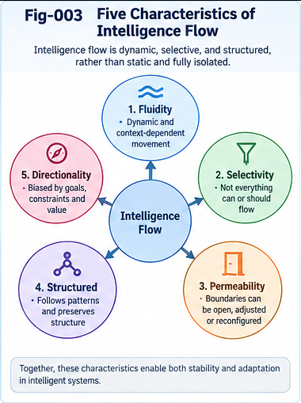

# CASE-001 — LLM Capability Spillover and Cross-Domain Transfer

**Project:** Intelligence Spillover, Generalization, Fluidity, Transfer, and Relay (ISGFTR)  
**Document type:** Illustrative research case and preregistrable experimental protocol  
**Version:** v1.0.0 (theory-first)  
**Status:** Proposed case study; illustrative examples are not experimental findings  
**Date:** 2026-10-31

## Abstract

A language model trained primarily to predict tokens can exhibit useful behavior on tasks that were not separately specified as training objectives. This observation motivates research into *capability spillover*, but it does not by itself establish genuinely new competence, out-of-distribution generalization, or progress toward artificial general intelligence (AGI). This case proposes a controlled study of whether a fixed large language model (LLM), when given structural representations, decomposition policies, and bounded tool interfaces, can transfer a source-domain procedure to a distinct target domain. The proposed design separates changes in model behavior from changes in the surrounding system; distinguishes prompt familiarity, memorization, and benchmark leakage from transferable structure; and tests whether apparent gains survive withheld tasks, altered terminology, perturbations, and independent replication. A paired example—dependency-aware planning in software maintenance and dependency-aware scheduling in a small service operation—illustrates a candidate structural core without assuming the two domains are equivalent. The case specifies baseline conditions, opportunity records, exploration and validation gates, negative controls, metrics, attribution rules, failure handling, and portable evidence packages. Its objective is to make possible spillover **discoverable, contestable, and reproducible**, not to claim that any particular LLM has passed the proposed tests.

**Keywords:** LLM; capability spillover; cross-domain transfer; structural generalization; folding; selective permeability; weak evidence; frozen-model evaluation; negative transfer; capability prospecting; evidence relay.

---

## 1. Research Question and Case Boundary

**Primary question.** Under what controlled conditions does a fixed LLM apply a reusable structural procedure from one task family to a distinct task family, and how can that behavior be distinguished from prompt scaffolding, direct domain knowledge, or system-level tool effects?

**Secondary questions.** (1) Can a compact, explicitly stated structural core outperform verbose source-domain examples? (2) When does the transfer fail? (3) Does a history of successful and failed transfer probes improve subsequent *system-level* prospecting while the LLM weights remain unchanged? (4) What evidence supports a claim of transfer rather than a one-off successful answer?

The unit of analysis is a **model–configuration–task–evaluation tuple**, not an undifferentiated claim that “the LLM is capable.” The model version, inference settings, prompts, external tools, task distributions, and evaluator versions must be recorded. The case does not infer an LLM's training-set composition or internal representations from output behavior alone.

## 2. Why This Case Matters

A model can solve a new-looking task for several distinct reasons: it may have encountered similar instances during pretraining; it may already possess the target-domain knowledge; a prompt may reveal the complete algorithm; a tool may perform the substantive work; or the model may successfully reuse an abstract relation. These explanations have different scientific implications. Calling all of them “spillover” would erase the very distinction ISGFTR aims to study.

We therefore use a deliberately narrow operational definition:

> **Candidate structural transfer:** performance on a target task improves after exposure to a source-domain structural procedure, under controls designed to exclude simple copying, extra token budget, and target-answer leakage.

This is an *observable experimental contrast*. It is not direct evidence of a particular neural mechanism, and it does not imply durable model-weight learning.



*Fig-003. Five distinguishable characteristics of intelligence flow and their possible interactions. Flow, successful transfer, and persistent growth remain separate empirical claims.*

## 3. Two Domains and Their Shared Candidate Core

### 3.1 Source domain: software maintenance planning

Consider a small software repository with a set of change requests, dependencies, estimated effort, deadlines, test requirements, and limited developer capacity. The task is to propose a feasible sequence of changes and tests, including a rationale for critical dependencies and contingency handling. A valid solution respects prerequisites and capacity constraints; a good solution also minimizes a prespecified cost such as weighted lateness or avoidable rework.

### 3.2 Target domain: neighborhood service scheduling

Consider a small service operation with customer jobs, travel times, equipment availability, crew skills, job prerequisites, and promised time windows. The task is to produce a feasible schedule and a justified contingency plan. Validity requires respecting skill, time-window, equipment, and precedence constraints. Quality can be assessed by lateness, travel, resource utilization, and rescheduling robustness.

### 3.3 Proposed transferable core

Both domains admit a candidate abstraction:

- Entities are tasks with typed attributes and constraints.
- Some tasks depend on others, inducing a directed dependency relation.
- Resources have capacities, availability windows, and eligibility rules.
- A feasible plan satisfies all hard constraints.
- Among feasible plans, an evaluator ranks tradeoffs among soft objectives.
- New information may require local repair rather than full replanning.

The abstraction can be written as a constraint-bearing task graph

$$
G=(V,E,\mathcal{R},\mathcal{C},\mathcal{O}),
$$

where $V$ denotes tasks, $E$ precedence edges, $\mathcal{R}$ resources, $\mathcal{C}$ constraints, and $\mathcal{O}$ evaluation objectives. This is an **analyst-proposed common representation**; its usefulness is an empirical question. For example, travel times and geography have no straightforward counterpart in many code-maintenance tasks, while software test dependencies may have no service-scheduling equivalent. These residuals must be preserved rather than forcibly folded into a false equivalence.

### 3.4 Structural core versus domain residual

| Element | Candidate common core | Source-specific residual | Target-specific residual |
|---|---|---|---|
| Task order | Directed precedence constraints | Build and test dependencies | On-site prerequisites |
| Capacity | Limited qualified resources | Developers, CI workers | Crews, equipment |
| Time | Durations, windows, deadlines | Release and test windows | Customer windows, travel |
| Quality | Feasibility plus cost | Regression risk, rework | Travel, lateness, service quality |
| Revision | Replan after changes | New defects and failed tests | Cancellations, traffic, weather |

**Transfer is supported only to the extent that the core helps and the residuals are correctly handled.**


*Fig-004. Hypothesized path from source observations to a reusable structural core and target-domain probes, with residuals, uncertainty, and validation retained explicitly.*

## 4. Research Hypotheses

**H1 — Structural-core advantage.** On held-out target tasks, a concise source-derived structural core improves constraint satisfaction or task utility relative to a token-matched generic instruction control.

**H2 — Cross-domain specificity.** Gains from the matched source core exceed gains from an unrelated but equally detailed source-domain procedure.

**H3 — Robustness beyond lexical overlap.** Any benefit persists when entity names, surface vocabulary, and presentation order are changed while the target constraints remain equivalent.

**H4 — Residual-aware transfer.** Explicitly identifying target-specific residuals reduces negative transfer compared with mechanically applying the source procedure.

**H5 — Two-gate efficiency.** A prospecting policy using inexpensive directional signals and a separate validation gate achieves more independently validated transfers per unit evaluation budget than ungated candidate selection.

**H6 — System-level relay learning.** With model weights frozen, a versioned registry of positive and negative transfer evidence improves future opportunity selection compared with a registry that preserves only successes, without necessarily changing per-instance model competence.

Each hypothesis may be rejected independently. A positive result for H1 does not establish H5, H6, or AGI.

## 5. Experimental Conditions and Attribution

Use the same pinned LLM and decoding configuration across the primary conditions. Randomize task order and condition assignment; where feasible, run repeated seeds or repeated stochastic samples. Equalize token and tool budgets within comparisons, or report the differences as costs.

| Arm | Information available | Purpose |
|---|---|---|
| A. Direct baseline | Target task only | Measure unassisted performance |
| B. Generic structure | Target task + generic planning checklist | Control for additional guidance |
| C. Unrelated source | Target task + token-matched irrelevant procedure | Control for verbosity and example exposure |
| D. Matched source examples | Target task + software-maintenance examples | Test example-mediated transfer |
| E. Folded structural core | Target task + abstract graph/constraint procedure | Test compact structural reuse |
| F. Core + residual mapping | Arm E + explicit target-specific constraints | Test selective transfer and negative-transfer reduction |
| G. Tools enabled | Arm F + bounded solver or verifier | Measure system-level augmentation separately |

Arms A–F should be evaluated without target-specific external solver assistance unless the same tool is provided identically across all arms. Arm G is reported as **system capability**, not automatically as an increase in the model's intrinsic competence.

An optional ablation removes the structural core while preserving residual descriptions. Another shuffles the source-to-target mapping to test whether gains depend on the proposed correspondence rather than generic verbosity.

## 6. Dataset and Task Construction

Construct a family of synthetic or openly licensed task instances with executable ground-truth validators. Prefer programmatically generated tasks with controlled complexity so that feasibility can be checked independently of model prose. A practical initial matrix includes:

- **Complexity:** small, medium, and stress-test instances, varied by task count, precedence density, resource contention, and constraint interactions.
- **Target variants:** ordinary terminology, renamed entities, shuffled input order, and unfamiliar but semantically equivalent labels.
- **Transfer distance:** near transfer with similar dependency patterns, intermediate transfer with new constraint types, and distant transfer where the analogy is deliberately weak.
- **Counterexamples:** instances where a source heuristic is misleading, such as minimizing task switches while travel constraints dominate.
- **Temporal revisions:** late-arriving jobs, unavailable resources, failed tests, or changed deadlines.

Generate and freeze a held-out evaluation set before comparing the arms. Maintain separate development and final test partitions; record generation seeds and task-construction code. If public benchmarks are included, treat training contamination as a material uncertainty and avoid claiming that public-set performance demonstrates unseen transfer.

To distinguish structure from terminology, generate matched *isomorphic pairs* in which the same abstract constraint graph is described using different domain language. Also include **non-isomorphic decoys** with superficial lexical similarity but materially different constraints. Both types are needed: isomorphic pairs test reuse, while decoys test whether the method overgeneralizes.

## 7. Prospecting Before Probing: Gate A

A prospect record identifies the proposed source capability, target task family, candidate shared structure, suspected residuals, available weak evidence, possible counterevidence, estimated probe cost, and expected information value. The prospect is not itself a capability claim.

A simple **exploration priority** can be defined for ranking only:

$$
Q(o)=w_v V(o)+w_i I(o)+w_s S(o)-w_c C(o)-w_r R(o),
$$

where $V$ is estimated task value, $I$ information gain, $S$ structural plausibility, $C$ cost, and $R$ risk. The components must be normalized or the weights otherwise justified. **$Q$ is not a calibrated probability of success.** Weights and thresholds must be fixed or versioned before evaluating held-out outcomes.

**Gate A** asks whether the opportunity is sufficiently well specified, safe, informative, and affordable to test. Rejection at Gate A means “not admitted for this experiment,” not “impossible transfer.”


*Fig-005. Weak-evidence directional guidance through selectively permeable research boundaries. Exploratory ranking, claim validation, and deployment permission are independent decisions.*

## 8. Registered Probe Protocol

Each admitted prospect receives a protocol with:

1. A frozen source and target task definition, including hard constraints and evaluation objectives.
2. Exact model identifier, inference settings, system prompts, tools, and resource ceilings.
3. Prespecified arms, randomization method, sample-size rationale, and evaluation partitions.
4. Primary metric, secondary metrics, statistical comparison, and uncertainty intervals.
5. Negative controls, contamination checks, and robustness transformations.
6. Explicit stopping rules, protocol-deviation handling, and failure reporting.
7. A rule for whether and how a claim can be promoted after review.

**Illustrative preregistration:** compare Arms E and B on a held-out target set using paired task-level differences in hard-constraint validity. Report a confidence interval for the difference and separately report cost-adjusted utility. If a numerical success threshold is selected, preregister it; do not choose it after observing the results. Repeated attempts on the same task must be counted and reported, not silently treated as a single independent trial.


*Fig-007. Capability prospecting across uncertain frontiers: opportunity generation, prioritization, probing, evidence-based claim revision, and feedback into future research.*

## 9. Evaluation and Measurement

The primary outcome should be **constraint-valid target performance**. A schedule that sounds plausible but violates a hard constraint is not a success.

| Metric | Operational meaning | Key caveat |
|---|---|---|
| Validity rate | Fraction of outputs satisfying all hard constraints | Requires independent checker |
| Utility conditional on validity | Objective value among valid plans | Can conceal low validity if reported alone |
| Cost-adjusted utility | Benefit net of tokens, latency, tools, and human review | Depends on explicit cost model |
| Transfer lift | Difference between matched-source and control performance | Does not isolate neural mechanism |
| Robustness | Performance under renamed, shuffled, and perturbed inputs | Perturbations must preserve intended semantics |
| Negative-transfer rate | Fraction of cases where transfer arm degrades relative to control | Report magnitude as well as frequency |
| Calibration | Alignment of stated confidence with observed correctness | Requires enough predictions and suitable scoring |
| Relay value | Improvement in later prospect selection from prior evidence | System-level effect, not model-weight learning |

For paired binary validity, report paired differences and appropriate uncertainty intervals; for continuous utilities, report distributional summaries and paired bootstrap intervals when justified. Predefine how infeasible outputs are scored. Publish both aggregate metrics and stratified outcomes by transfer distance and constraint type to expose failures hidden by averages.

## 10. Gate B: What Can Actually Be Claimed?

Gate B reviews the registered protocol, complete outputs, independent validation, deviations, and counterevidence. Possible decisions include **unsupported**, **provisionally supported within scope**, **contested**, or **replicated within scope**. A positive result may support a narrow statement such as:

> Under a fixed model and bounded evaluation protocol, supplying a source-derived constraint-graph abstraction improved target-domain plan validity relative to a matched generic-control prompt on the held-out task family.

It does **not** by itself support claims that the model learned new weights, invented a novel algorithm, acquired human-like intuition, crossed a universal intelligence threshold, or can transfer arbitrarily across domains. Tool-enabled success must be labeled as model-plus-system performance.

A finding should remain provisional if it disappears under vocabulary perturbation, relies on public benchmark familiarity, cannot be reproduced, or has unreported costs. Contradictory evidence should change the claim state rather than be excluded from the record.

## 11. Failure Modes and Counterarguments

### 11.1 Prompt engineering masquerading as transfer

The structural-core prompt may simply provide a better instruction template. The generic-structure and unrelated-source controls help assess this possibility, but cannot completely identify internal causality. The appropriate conclusion may be “structured prompting improves task performance,” not “new intelligence emerged.”

### 11.2 Prior exposure and memorization

Both domains may already be familiar from training. Synthetic held-out instances, altered terminology, and contamination checks reduce—but cannot eliminate—this concern. Novel input instances are not proof that the underlying procedure was absent from pretraining.

### 11.3 Source-to-target mismatch

A dependency graph is too coarse when travel time, stochastic arrivals, safety rules, or domain-specific failure modes dominate. The experiment should include such cases intentionally and report the boundary at which transfer ceases to help.

### 11.4 Tool substitution

If a solver computes the plan, the system may improve dramatically without demonstrating that the LLM performed the planning. Record which component generated candidates, validated constraints, repaired errors, and selected outputs.

### 11.5 Evaluation leakage and evaluator weakness

If the model sees answers, uses the same verifier as the scorer, or learns the final test cases during tuning, estimated transfer lift may be inflated. Independent validators and held-out splits are essential. A validator itself may be wrong; spot-check a sample manually and publish known checker limitations.

### 11.6 Selection and publication bias

Testing many analogies and publishing only successful ones overstates the prevalence of spillover. Record all admitted opportunities, including failures, rejected probes, and aborted experiments with reasons.

### 11.7 Coordination and operational costs

Even genuine transfer may be uneconomical when mapping and validation cost more than directly solving the target task. Report utility net of exploration, adaptation, and review costs.

## 12. Temporal Relay and Frozen-Model Collective Learning

After each probe, preserve a portable evidence package containing the opportunity, source/target mapping, protocol, results, counterexamples, claim state, and unresolved residuals. A subsequent research cycle may use these packages to choose which analogies to test next. This is **temporal relay**: knowledge is carried across experiments without requiring the base model's parameters to change.

Compare three prospecting policies under the same future evaluation budget:

- **No history:** choose candidates without previous outcomes.
- **Success-only history:** use previously positive cases but discard negative cases.
- **Full evidence history:** use successes, failures, boundary conditions, and counterevidence.

The primary endpoint is independently validated target utility per budget, not merely the number of opportunities proposed. If the full-history policy outperforms controls, that supports **system-level learning from evidence relay**. It does not demonstrate learning within the frozen LLM. If it fails, the negative result is still valuable: it identifies limits in representation, evidence selection, or routing.

Repeated execution counts as a relay event only if it leaves a traceable record; it counts as learning only if later decisions demonstrably improve under controlled comparison.


*Fig-008. Recursive evidence-bearing relay across systems and time. Durable growth is an outcome to be tested, with negative results, saturation, and rollback explicitly represented.*

## 13. Alignment With the ISGFTR Contracts

| Contract | Required artifact in this case | Example compliance check |
|---|---|---|
| `SPEC-001` | Scoped capability profile and boundary assertions | No unconditional “LLM can schedule” claim |
| `SPEC-002` | Spillover Opportunity Record (SOR), evidence and counterevidence | Opportunity priority not labeled probability |
| `SPEC-003` | Gate A, registered probe, Gate B decision, deviations | No claim promotion before review |
| `SPEC-004` | Structural Relay Unit (SRU), provenance, recipient assessment | Recipient does not inherit source validation automatically |

The case should use the normative contracts as proposed research interfaces, not claim compliance with an external industry standard.

## 14. Illustrative Machine-Readable Case Manifest

The following YAML is **illustrative**; it is not a complete schema implementation or a validated experiment record.

```yaml
case_id: ISGFTR-CASE-001
version: 1.0.0
status: proposed-not-executed
source_domain: software-maintenance-planning
target_domain: service-scheduling
model:
  id: TO_BE_PINNED
  weights_frozen: true
  decoding_config: TO_BE_REGISTERED
capability_claim:
  state: hypothesized
  scope: held-out constraint-bearing planning instances
  attribution: model-plus-prompt
candidate_core:
  representation: typed-task-graph
  relations: [precedence, capacity, eligibility, time-window]
  known_residuals: [travel-time, customer-windows, test-dependencies]
prospect:
  opportunity_id: ISGFTR-CASE-001-OPP-01
  directional_priority: uncalibrated
  gate_a: pending
probe:
  protocol_id: ISGFTR-CASE-001-PROTOCOL-01
  preregistered: false
  arms: [direct, generic, unrelated, source-examples, folded-core, core-plus-residual, tools-enabled]
  primary_metric: hard-constraint-validity
  held_out_evaluation: required
  gate_b: not-evaluated
evidence:
  positive: []
  negative: []
  counterexamples: []
  provenance: pending
relay:
  package_id: pending
  recipient_validation: required
```

Before an actual study, populate all placeholders, pin the dataset generator and evaluator, and preserve exact prompt templates and source files. Never replace the `proposed-not-executed` status with a success claim without executing and reviewing the experiment.

## 15. Minimum Viable Research Implementation

A practical first implementation can remain small and auditable:

**Phase 1 — Validator first.** Implement task-instance generators and deterministic constraint checkers for both domains. Test them against hand-verified feasible and infeasible examples.

**Phase 2 — Frozen-model baselines.** Run Arms A–C with pinned prompts and budgets; publish failures and cost profiles before optimizing transfer prompts.

**Phase 3 — Structural transfer.** Introduce Arms D–F and the isomorphic/non-isomorphic controls. Evaluate both average lift and negative-transfer frequency.

**Phase 4 — System attribution.** Add bounded tools in Arm G, but report solver contribution and model contribution separately.

**Phase 5 — Relay comparison.** Test the no-history, success-only, and full-history prospecting policies on fresh opportunities and held-out target instances.

Each phase has a stop/go decision based on validity, reproducibility, and information value. Failure at an early phase should not be concealed by advancing to a more complex system.

## 16. Research Deliverables and Reproducibility Package

A complete experimental release should contain a versioned task generator, frozen splits and seeds, prompts for all arms, model configuration, evaluation scripts, raw outputs, validity-check logs, statistical analysis, cost accounting, preregistration, protocol deviations, counterexamples, and a machine-readable SOR/SRU lineage. If model access is restricted, disclose the limitation and provide enough metadata for independent approximate replication.

Preserve both the original and any revised protocol. A revised experiment is a new version, not a retroactive replacement of the preregistered one. Distinguish code availability, data availability, and model availability explicitly.

## 17. Interpreting Possible Outcomes

| Observation | Supported interpretation | Interpretation not justified |
|---|---|---|
| Core beats generic control, robustly | Useful structure-conditioned target improvement | New model weights or general AGI |
| Examples help, core does not | Example-specific guidance may matter | Universal folding/generalization duality |
| Tool arm alone improves | System augmentation is effective | Intrinsic LLM planning gain |
| Transfer harms distant tasks | Structural mismatch or negative transfer | All transfer is impossible |
| Full evidence registry improves later choices | Evidence-based system learning | Frozen model internally learned |
| No arm reliably improves | Hypothesis unsupported in this setting | No possible LLM spillover anywhere |

The case is useful precisely because different outcomes distinguish different mechanisms and research directions.

## 18. Open Questions

1. What is the smallest structural core that still yields a robust cross-domain benefit?
2. How should transfer distance be measured when representations are not naturally Euclidean?
3. Can a model recognize target residuals without being explicitly told what they are?
4. Which weak evidence is most informative for selecting source-to-target mappings?
5. How does transfer reliability change with constraint complexity and stochastic environments?
6. Does explicit uncertainty reporting improve decision quality or merely increase verbal caution?
7. How much of apparent transfer can be explained by prompt organization alone?
8. When does negative evidence improve future prospecting more than additional positive examples?
9. Can independent laboratories reproduce a reported transfer with different model families?
10. Which aspects of the method generalize beyond language-mediated tasks?

## 19. Collective Learning and Research Relay Invitation

Researchers are invited to submit **both confirmations and counterexamples**. Useful contributions include better target-domain validators, new decoy analogies, transfer-distance taxonomies, ablations, alternative model families, independent replications, and critiques of attribution. A contribution should identify its exact claim scope and distinguish new evidence from commentary or speculation.

A negative finding that sharply delineates where the source core fails may be more valuable than an unqualified positive result. A portable result should preserve the conditions under which it was obtained, the conditions under which it failed, and the unresolved questions that could guide the next probe.

## 20. Conclusion

This case turns a broad idea—LLM capability spillover across task boundaries—into a constrained, falsifiable research program. The central experiment is not whether an LLM can produce plausible prose about two domains. It is whether a proposed common structure produces **measurable, robust, cost-aware improvements** on held-out target tasks under meaningful controls. The design also tests whether explicit residual handling prevents negative transfer and whether evidence relay improves later prospect selection with fixed model weights. Any successful outcome should be attributed narrowly to the tested model–prompt–tool–task system; any failure should be retained as evidence. This disciplined separation of possibility, observation, validation, adoption, and growth is the intended contribution to ISGFTR's open collective-learning agenda.

---

**Related ISGFTR documents:** `ISGFTR-003`, `ISGFTR-004`, `ISGFTR-005`, `ISGFTR-006`, `ISGFTR-007`, `ISGFTR-008`, `ISGFTR-009`, `ISGFTR-010`; `SPEC-001` through `SPEC-004`.

**Document status:** Theory-first proposed case. No benchmark result, successful transfer, or empirical validation is claimed in this version.
