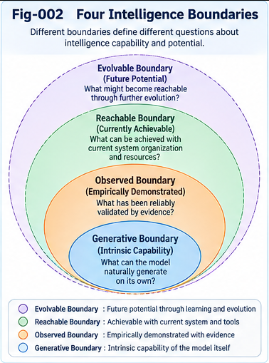
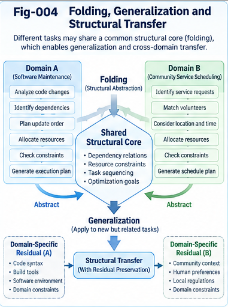
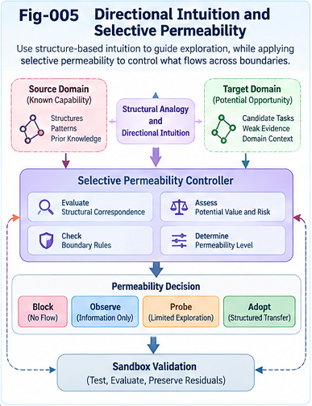

# ISGFTR-003 — Folding–Generalization Duality and Structural Reuse

**Project:** Intelligence Spillover, Generalization, Fluidity, Transfer, and Relay (ISGFTR)  
**Document type:** Mechanism hypothesis, conceptual model, and testable research agenda  
**Version:** 1.0.0 (theory-first)  
**Status:** Open research hypothesis; no empirical validation is claimed  
**Date:** 2026-10-30  
**Companions:** [ISGFTR-001 — From Static Intelligence Boundaries to Open Capability Frontiers](ISGFTR-001-From-Static-Intelligence-Boundaries-to-Open-Capability-Frontiers.md); [ISGFTR-002 — Five Characteristics of Intelligence Spillover and Relay](ISGFTR-002-Five-Characteristics-of-Intelligence-Spillover-and-Relay.md)

## Abstract

A learned or engineered representation may be more useful beyond its original task when it retains reusable structure while discarding task-specific detail. This paper examines a proposed *folding–generalization duality*: certain forms of structural folding can enable transfer by distilling a shared core that can be unfolded or adapted in new contexts. The term *duality* is used as a research heuristic, not as a mathematical equivalence or a claim that compression necessarily yields generalization. We distinguish lossless compression, lossy task-oriented abstraction, structural distillation, and downstream reconstruction; introduce explicit core, context, residual, and uncertainty terms; and analyze when folding preserves the information required for transfer. The resulting framework connects intelligence spillover to structural reuse, perspective changes, weak-evidence prospecting, and two-phase validation. We specify negative-transfer mechanisms, operational baselines, ablations, and falsifiable hypotheses. The aim is to make a potentially useful connection between representation economy and capability extension accessible to collaborative investigation, without claiming a new universal learning law or a demonstrated path to artificial general intelligence.

## 1. Motivation: Why a Smaller Representation Might Reach Further

A system trained to solve one family of problems may acquire representations useful for other families. This is familiar in transfer learning and representation learning; what remains difficult is predicting *which* representations will travel, *why* they work in a new setting, and *when* the transfer will fail. A compact representation can suppress accidental details and expose regularities shared across tasks. Yet the same compression can remove rare but decisive variables, causal distinctions, or safety constraints.

ISGFTR-001 separates the **generative**, **observed**, **reachable**, and **evolvable** capability boundaries. ISGFTR-002 distinguishes spillover, generalization, fluidity, transfer, and relay. This paper investigates a possible bridge between them: a reusable structural core obtained by folding observations, procedures, or task descriptions, then adapted through context-sensitive unfolding.

**Research question:** Under what measurable conditions does structural folding improve generalization or cross-domain transfer, and when does it instead cause information loss, false analogy, or negative transfer?

We do not assume that a language model literally executes an explicit folding algorithm. In this paper, *folding* is a proposed analytic and engineering abstraction that may be instantiated by several mechanisms. Identifying the actual mechanisms of any particular model requires separate evidence.

*Fig-002. Four context-dependent capability boundary questions. The illustration does not imply that the boundaries are necessarily nested, complete, or directly measurable on one axis.*

## 2. Terminology and Scope

### 2.1 Folding

**Structural folding** denotes a mapping from a richer source representation into a more compact or reusable representation while attempting to retain specified relations, invariants, or decision-relevant information. Folding can be lossy; the retained structure and the intended use must therefore be declared.

### 2.2 Shared core and residual

A **shared core** is a representation of relationships hypothesized to remain useful across a specified family of tasks. A **residual** is the task- or context-specific information not represented by that core, including unresolved distinctions and counterexamples. Neither term implies that the core is unique or objectively universal.

### 2.3 Unfolding

**Unfolding** is a context-conditioned construction of a task representation, candidate procedure, or output using a reusable core plus target-specific information. It need not reconstruct the original input exactly. It may produce an adaptation rather than an inverse.

### 2.4 Generalization, transfer, and spillover

**Generalization** is performance on appropriately held-out cases under a specified evaluation distribution. **Transfer** is measurable benefit from reusing source knowledge in a target task, compared with a matched no-transfer baseline. **Spillover** describes a useful function discovered outside the original training or design focus. A single episode may exhibit all three, but evidence for one does not automatically establish the others.

### 2.5 The meaning of “duality”

The proposed *folding–generalization duality* is a **conditional relationship**: folding may help discover invariant structure; successful transfer may reveal which structures were worth folding. It is not a mathematical duality theorem, an invertible transform, or an assertion that shorter descriptions always generalize better.

## 3. A Minimal Structural Model

Let a source problem representation be \(x\), a source context \(c_s\), and a candidate folding operator \(F_\phi\). Define

\[
 z=F_\phi(x,c_s), \qquad r=R_\phi(x,c_s;z),
\]

where \(z\) is a proposed reusable core and \(r\) records residual information not retained in \(z\). For a target context \(c_t\), an unfolding or adaptation operator produces

\[
 \hat y_t=U_\psi(z,c_t,a_t),
\]

where \(a_t\) denotes additional target evidence, tools, or constraints. In a concrete system, \(r\) might be stored for later retrieval, represented as a distribution of uncertainty, or unavailable because it was discarded. These choices are experimentally consequential.

A candidate structural transfer is useful only if it improves a target-specific criterion under matched resources:

\[
 \Delta_{\mathrm{transfer}}
 = Q_t(U_\psi(F_\phi(x,c_s),c_t,a_t))
 -Q_t(B_t),
\]

where \(Q_t\) is the target evaluation and \(B_t\) is a properly budget-matched baseline. Positive \(\Delta_{\mathrm{transfer}}\) on one benchmark does not establish a generally reusable core. Its stability across target shifts and trials must be examined.

A separate compression statistic, such as description length or representation dimensionality, can be recorded, but should not be substituted for transfer utility. A smaller \(z\) can be worse, better, or equivalent depending on the task and the information discarded.

*Fig-004. Hypothesized path from source observations to a reusable structural core and target-domain probes, with residuals, uncertainty, and validation retained explicitly.*

## 4. Why Folding Could Support Generalization

### 4.1 Removing incidental variation

Different observations may share a decision-relevant relation while differing in surface format, naming, sensor noise, or incidental context. A suitable folding operation can make the common relation easier to access. This resembles established ideas in invariant representation learning and abstraction; ISGFTR proposes to connect these ideas explicitly to capability-frontier exploration.

### 4.2 Reducing search and adaptation costs

A reusable core may reduce the amount of target-specific exploration needed. Rather than rediscovering an entire procedure, a system may search only over the residual gap between source and target. This benefit should be measured as *performance at equal cost* or *cost at equal performance*, not inferred from an elegant representation alone.

### 4.3 Enabling compositional reuse

A core can potentially be combined with other cores, tools, or constraints. Compositional reuse may create new reachable task configurations without any single component having been trained for the entire composite task. However, incompatible assumptions and interface mismatches can defeat the combination.

### 4.4 Revealing prospective spillover

A folded structure may make similarities between previously unrelated tasks visible to an evaluator. This is a **prospecting hypothesis**, not evidence that the model already possesses the target capability. A low-cost probe is still needed.

### 4.5 Reverse direction: transfer tests refine the core

Failed target transfers can identify missing conditions, misleading invariants, or overbroad abstractions. The system may then refine \(F_\phi\), attach boundary conditions to \(z\), or maintain several perspective-specific cores rather than one universal representation.

## 5. What Must Be Preserved?

A transferable representation is not merely compact. It should preserve whatever information is relevant to the target family, which may include:

1. **Relational structure:** dependencies, order, topology, and causal or functional connections.
2. **Operational constraints:** admissible actions, permissions, resources, and safety conditions.
3. **Perspective and objective:** whose utility is being optimized and under what evaluation rule.
4. **Boundary conditions:** assumptions under which the source mechanism remains valid.
5. **Uncertainty and provenance:** what is known, inferred, hypothesized, or contradicted.
6. **Recoverable residuals:** information that can be reintroduced when a new target exposes a gap.

The importance of each dimension is domain-dependent. A geometric control task may require metric properties; a legal or governance task may require provenance and authority; a language task may depend on contextual distinctions that are hard to encode in a small symbolic core.

**Working principle:** Preserve task-relevant structure and uncertainty before optimizing representation compactness.

## 6. Structural Reuse Is Not Formal Equivalence

Two tasks may share a useful partial pattern without being formally equivalent. A source strategy can sometimes serve as a *candidate* in the target even when the systems have different variables, objectives, or dynamics. This is particularly important for directional intuition and weak-evidence search.

Consider a familiar analogy between water flow and electrical current. Both may support reasoning about networks, bottlenecks, and conservation-like relationships under carefully specified conditions. Yet the analogy fails if their distinct physical laws or boundary conditions are ignored. Structural affinity is therefore a reason to **probe**, not a license to assert equivalence.

We distinguish three levels:

- **Exact structural correspondence:** specified relations and constraints are preserved under a known mapping.
- **Partial transferable correspondence:** selected relations are useful, but important residual differences remain.
- **Directional resemblance:** weak evidence suggests a candidate route that has not yet been validated.

A robust system should attach different evidence standards and execution permissions to each level. In particular, directional resemblance should not silently become an executable high-confidence contract.

## 7. Uncertainty-Preserved and Uncertainty-Recovering Unfolding

An aggressive folding operation can hide the very information needed to assess transfer. There are at least two complementary approaches.

**Uncertainty-preserved folding** retains distributions, confidence qualifiers, alternate hypotheses, or explicit unresolved variables alongside the core. This may be expensive but supports later context-sensitive decisions.

**Uncertainty-recovering unfolding** permits an initially compact core to generate candidates, then obtains fresh target evidence through probes, retrieval, tools, or controlled experiments. This is often more practical when the required uncertainty representation cannot be anticipated at folding time.

Neither approach is universally superior. The first may improve traceability but increase storage and design burden; the second may reduce initial cost but fail if critical distinctions are unrecoverable or probes are unavailable.

A hybrid design can retain high-risk boundary conditions and provenance while recovering lower-priority details as needed. The design should explicitly record which uncertainties were preserved, which were deferred, and which were lost.

## 8. Folding, Directional Intuition, and Two-Phase Search

A useful prospecting system need not demand proof of transfer before generating a candidate. It can use low-cost structural cues to direct limited exploration budgets.

**Phase 1 — Candidate discovery:** Generate source–target hypotheses using shared relations, partial concept alignment, historical transfer precedents, metric-native directional signals, and residual or OTHERS cues. Rank opportunities for investigation while preserving uncertainty.

**Phase 2 — Target validation:** Test candidate mappings against held-out target tasks, cost and safety constraints, counterexamples, and matched baselines. Update the reputation of the candidate core and its transfer conditions.

This two-phase pattern connects to the project's companion work on weak-evidence prospecting without asserting that weak evidence is reliable by itself. A high prospecting score should mean “worth testing under stated constraints,” not “transfer is already established.”

An illustrative opportunity score is

\[
 S(o)=f(A_{\mathrm{structure}},D_{\mathrm{direction}},H_{\mathrm{precedent}},
 R_{\mathrm{residual}},U_{\mathrm{uncertainty}},C_{\mathrm{probe}}).
\]

The function \(f\) must be learned, calibrated, or specified for a concrete application. Its inputs are not necessarily commensurate; the expression is a design placeholder rather than a validated formula. In particular, an OTHERS term should be accompanied by a source, reason for inclusion, and falsification route.

*Fig-005. Weak-evidence directional guidance through selectively permeable research boundaries. Exploratory ranking, claim validation, and deployment permission are independent decisions.*

## 9. Failure Modes and Counterarguments

### 9.1 Compression destroys rare but decisive information

A representation that performs well on common cases may discard a low-frequency exception that matters in a new domain. Evaluation must include tail cases and boundary-condition stress tests.

### 9.2 Superficial analogy masquerades as invariant structure

Shared vocabulary or geometry can create misleading similarity. Compare against lexical-only, embedding-only, and randomized-mapping baselines; test interventions that break surface similarity while preserving deeper relations, and vice versa.

### 9.3 Hidden target information contaminates the source core

If target examples influence folding or model selection, reported transfer may be data leakage rather than genuine prospective generalization. Source/target separation and pre-registered protocols matter.

### 9.4 Added machinery, not folding, produces the gain

A folded-core pipeline may receive more compute, tools, or expert tuning than a baseline. Fair tests must match budgets and separately ablate each added component.

### 9.5 A core is too broad to be useful

An abstraction that applies to everything may provide little discriminative guidance. Evaluate whether it predicts which transfers fail as well as which succeed.

### 9.6 Reuse is mistaken for durable growth

A task may succeed because a known procedure was retrieved or a capable tool was called. Durable growth requires later improvement that persists under a defined retention test, not merely a successful one-off handoff.

### 9.7 “Duality” is interpreted too strongly

There is no proposed theorem that optimal compression and optimal generalization coincide. In many settings, more detailed representations outperform compressed ones. The duality is conditional, empirical, and revisable.

## 10. Testable Hypotheses

**H3.1 — Structure-preserving advantage.** Under matched compute and data budgets, folding methods that explicitly preserve task-relevant relations will outperform size-matched generic compression on a defined family of held-out transfer tasks.

**H3.2 — Residual-aware adaptation.** A core-plus-residual system will outperform core-only unfolding under shifts that alter source boundary conditions, provided residual information is available and correctly used.

**H3.3 — Two-phase discovery efficiency.** Weak-evidence candidate ranking followed by controlled validation will discover more useful transfers per fixed probing budget than random exploration and similarity-only ranking on selected task suites.

**H3.4 — Failure-informed core revision.** Updating a core's boundary conditions from documented failed transfers will reduce repeated negative transfer on future related tasks without an unacceptable decline in successful transfer coverage.

**H3.5 — Conditional compositional reuse.** Composing independently validated cores will improve performance on some unseen composite tasks relative to no-composition controls, but the benefit will depend on interface and assumption compatibility.

**H3.6 — Compression is not sufficient.** Across target distributions, representation size alone will be an unreliable predictor of transfer performance after controlling for retained structure, data, and model capacity.

Each hypothesis can fail. Negative or mixed results are valuable if they specify the domains and mechanisms for which the proposed relationship does not hold.

## 11. Suggested Experiments and Baselines

### Experiment A — Shared-core discovery under controlled distribution shift

Construct task families with known shared rules and nuisance variables. Compare (i) no transfer, (ii) raw-source reuse, (iii) generic low-dimensional compression, and (iv) explicitly structure-preserving folding. Hold training data, target exposure, and inference budgets constant. Report target accuracy, sample efficiency, calibration, and worst-group performance.

### Experiment B — Counterexample and residual retention

Introduce rare but important exceptions into source tasks. Compare core-only, core-plus-explicit-residual, and core-plus-active-probing systems on targets where the exception becomes frequent. Report false transfers, recovery cost, and performance after receiving counterevidence.

### Experiment C — Directional transfer prospecting

Provide a fixed library of source capabilities and unseen candidate targets. Blind the ranking system to final outcomes. Compare random, lexical similarity, embedding similarity, hand-authored rules, and structural weak-evidence scoring. At a fixed number of probes, measure valid discoveries, precision among selected probes, total cost, and diversity of successful target families.

### Experiment D — Compositional relay

Evaluate whether two or more cores can be combined to solve tasks that no single core solves under matched budgets. Track interface conversion, failure propagation, tool dependence, and whether the resulting ability persists on a later held-out set. This experiment connects folding to relay but does not assume that relay itself creates new learning.

### Experiment E — Prospective versus retrospective evaluation

Use historical transfers only to fit or specify the evaluator, then freeze it before ranking later targets. This reduces hindsight bias and tests whether the framework can prospect rather than merely explain known successes.

**Reporting requirements:** Publish successful and failed transfers; disclose model versions, task distributions, target exposure, computation and tool budgets, confidence intervals, and known contamination risks. For high-impact domains, include explicit safety and authorization constraints.

## 12. Connections to Other ISGFTR Components

- **ISGFTR-001:** A folded representation may support an extension from the observed to the reachable frontier; the actual extension must be measured.
- **ISGFTR-002:** Folding is a possible mechanism underlying generalization and transfer, not a synonym for either. Spillover is a separate descriptive claim about original focus.
- **ISGFTR-004:** Permeable structural boundaries may allow a partial core to influence another task before exact equivalence is known.
- **ISGFTR-005:** Directional intuition can nominate candidate mappings that strict structural matching would exclude.
- **ISGFTR-006:** System-centric learning can modify which cores are available, how they are routed, and what residuals are stored, even if model weights remain unchanged.
- **ISGFTR-007:** Relay can transport cores, evidence, and failure histories across agents or time, with possible loss or distortion.
- **ISGFTR-008:** Prospecting can evaluate the expected usefulness of candidate folds and transfers before full execution.

Related Structural Intelligence research directions include structural folding/unfolding, differential trees, common-concept core distillation, two-phase search, perspective-aware scoring, residual-driven growth, and portable intelligence units. These connections are proposed research interfaces, not evidence of shared implementation or experimental success.

## 13. Open Questions

1. What constitutes a task-relevant structural invariant when the target distribution is unknown?
2. Can reusable cores be discovered without assuming a fixed ontology or formal interface?
3. When is uncertainty better preserved during folding, and when should it be recovered during unfolding?
4. How can a system distinguish causal structural similarity from coincidental correlations?
5. What is the appropriate unit of transfer: feature, relation, policy, subgraph, tool, or whole intelligence unit?
6. How should perspective-specific cores be reconciled when their objectives conflict?
7. Can a prospecting evaluator learn from failures without collapsing toward conservative, near-domain transfers only?
8. What evidence distinguishes successful structural reuse from a powerful base model solving the target independently?
9. How can transfer experiments capture temporal relay and long-term retention without confounding them with simple memory retrieval?
10. Which classes of target problems fundamentally resist a given folding scheme, and how should these limitations be represented?

## 14. Collective Learning and Research Relay

The most useful next contribution may not be a new architecture. It may be a counterexample, a carefully documented failed transfer, a better operational definition of “core,” or a benchmark in which a compact representation performs worse than an uncompressed one. The proposed framework is intended to support such contributions.

A portable research record should contain: source task and model, folding method, core definition, preserved and discarded information, target task, mapping hypothesis, evidence and counterevidence, evaluation protocol, compute budget, results, and unresolved residuals. Independent teams can then test the same claim or substitute a competing mechanism.

We invite work that replaces broad metaphor with precise mappings, calibrates opportunity scores, establishes negative-transfer boundaries, and develops lightweight interfaces for reproducible structural relay. No exclusive terminology or implementation is required for participation.

## 15. Conclusion

Folding can sometimes make knowledge more transferable by emphasizing shared relations and reducing incidental variation. It can also conceal essential distinctions and cause negative transfer. The useful research claim is therefore conditional: **structure-preserving folding, together with context-aware unfolding, residual handling, and validation, may extend the effective reach of an intelligence system under identifiable conditions**. Transfer outcomes can in turn refine the core and its boundary conditions. This is the proposed folding–generalization duality: a feedback relationship between abstraction and demonstrated reuse, not a guarantee that compression produces intelligence.

The next document, **ISGFTR-004**, examines intelligence fluidity and selectively permeable structural boundaries as possible mechanisms for discovering and routing these candidate transfers.

---

## Related Research Areas (Orientation)

Relevant established research traditions include information bottleneck methods, minimum description length, representation learning, invariant prediction, transfer learning, domain adaptation, compositional generalization, abstraction in reinforcement learning, causal representation learning, and continual learning. A scholarly revision should add verified primary references and clearly distinguish established results from ISGFTR-specific hypotheses. This document makes no claim to first discovery of compression-based generalization or structural transfer.

## Document Status

**ISGFTR v1.0.0 — theory-first.** All operators, scoring expressions, and experiment designs above are proposed conceptual constructs. No trained folding model, validated transfer benchmark, or AGI capability is claimed.
