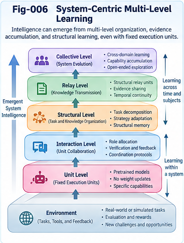
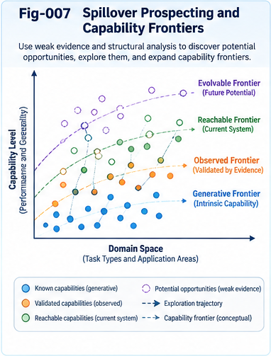
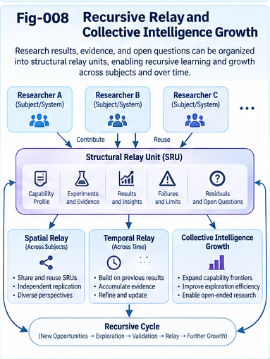

# ISGFTR-010 — An Open Research Architecture for Collective Learning

**Project:** Intelligence Spillover, Generalization, Fluidity, Transfer, and Relay (ISGFTR)  
**Document type:** Integrative research architecture, proposed interfaces, and validation roadmap  
**Version:** v1.0.0 (theory-first)  
**Status:** Open research proposal; not a validated implementation or claim of AGI  
**Date:** 2026-10-30

## Abstract

The preceding nine ISGFTR papers examine capability spillover, generalization, intelligence fluidity, structural transfer, evidence-bearing relay, system-centric learning, recursive growth, and active capability prospecting. This paper proposes an **open research architecture** that makes these ideas investigable together without requiring agreement on a single intelligence model, representation, runtime, or theory of artificial general intelligence. Its central unit is not an unqualified claim of new capability but a *traceable capability hypothesis*: a statement of the source and target conditions, proposed structural bridge, uncertainty, evaluation plan, observed outcomes, and remaining limitations. Such hypotheses can be discovered through weak evidence, tested through bounded probes, validated against independent controls, and relayed as portable research artifacts.

The architecture separates a **prospecting plane**, **execution and experiment plane**, **evidence and evaluation plane**, **structural relay plane**, and **governance plane**. It also distinguishes learning at the unit, interaction, structural, relay, collective, and evolutionary levels. A two-gate policy permits low-cost exploratory hypotheses while requiring stronger evidence before operational reuse. We outline canonical research objects, lifecycle transitions, interface contracts, failure handling, multi-party replication, benchmark designs, and a phased implementation roadmap. The proposal is deliberately theory-first: it offers interoperable specifications and falsifiable experiments rather than claiming that the architecture already produces durable general intelligence. Its intended outcome is an auditable, corrigible, and collective-learning-friendly research ecosystem in which both successful and unsuccessful transfer attempts can advance understanding.

**Keywords:** structural intelligence; capability prospecting; open research architecture; collective learning; structural relay; generalization; transfer; evidence provenance; evaluation governance; negative results; system-centric intelligence; AGI research boundaries.

---

## 1. Purpose and Research Position

ISGFTR begins with a simple distinction: the capabilities a system has *demonstrated* are not necessarily identical to the capabilities it might *reach* through different representations, task decompositions, collaborators, tools, or learning structures. Yet this observation does not establish that such additional capabilities exist, that they are useful, or that their discovery will continue indefinitely.

The first nine papers progressively sharpen the distinction:

- **ISGFTR-001** introduces open capability frontiers and separates generative, observed, reachable, and evolvable boundaries.
- **ISGFTR-002** defines the five related but nonidentical characteristics: spillover, generalization, fluidity, transfer, and relay.
- **ISGFTR-003** studies folding–generalization duality, structural reuse, and uncertainty preservation or recovery.
- **ISGFTR-004** studies fluidity across selectively permeable structural boundaries.
- **ISGFTR-005** explores directional intuition and weak-evidence transfer without treating intuition as validation.
- **ISGFTR-006** distinguishes system-level learning from the capabilities and parameter updates of individual execution units.
- **ISGFTR-007** analyzes spatial, temporal, and recursive relay, including repeated execution as possible evidence accumulation.
- **ISGFTR-008** formulates capability prospecting as an active, budgeted, falsifiable search process.
- **ISGFTR-009** examines AGI implications, counterarguments, alternative explanations, and failure conditions.

The present paper asks how independent researchers could *work together* on these claims. A useful architecture must allow competing theories to share observations without conflating hypotheses with results. It must also preserve negative evidence, disagreements, provenance, and the conditions under which a transfer was or was not reproduced.

### 1.1 Design objective

The objective is **research interoperability before runtime uniformity**. A common evidence and relay vocabulary should be useful even when participants employ different models, programming languages, laboratories, or experimental procedures.

### 1.2 Non-objectives

This proposal does **not** assert that ISGFTR mechanisms are new relative to all prior work; that a single score measures intelligence; that repeated relay automatically improves competence; that multi-agent orchestration proves learning; or that a shared architecture establishes an AGI pathway. Those are questions for comparative research.

---

## 2. Design Principles

### 2.1 Contracts before implementation

Specify what a capability claim, experiment, and relay artifact must disclose before standardizing how agents execute them. An interface can be shared without forcing a shared internal architecture.

### 2.2 Evidence before promotion

A plausible analogy is an invitation to test, not a verified transfer. Operational promotion requires explicitly stated thresholds, independent controls where feasible, and provenance.

### 2.3 Perspective-aware evaluation

Success depends on the evaluator, domain, stakeholder, constraints, and loss function. The same transfer may improve one objective while harming another. Preserve the evaluation perspective rather than folding all judgments into an unexplained number.

### 2.4 Explicit residuals and negative outcomes

Unresolved assumptions, failed probes, negative transfer, and contradictory findings are reusable research artifacts. A relay system that transmits only success stories will accumulate selection bias.

### 2.5 Selective permeability

Exploratory discovery should be inexpensive and open to unconventional connections; deployment and consequential action should remain gated. This distinction is central to both research quality and governance.

### 2.6 Bounded, reversible growth

New structures should be versioned, tested, and reversible. Larger architectures are not necessarily more intelligent; complexity and maintenance costs belong in evaluation.

### 2.7 Collective learning without compulsory centralization

Researchers may exchange standardized artifacts while retaining independent models, evaluation procedures, and decision rights. Shared learning should not require a single global controller or surrender of subject sovereignty.

---

## 3. Reference Architecture: Five Interacting Planes

The following is a logical architecture, not a prescribed physical deployment.

| Plane | Primary question | Candidate functions | Principal output |
|---|---|---|---|
| Prospecting | What might transfer? | Gap identification, structural analogies, weak-evidence ranking, question generation | Candidate capability hypotheses |
| Experiment and execution | What happens under a bounded test? | Task decomposition, tool routing, sandboxes, controlled probes | Execution traces and observations |
| Evidence and evaluation | What is supported? | Baselines, uncertainty, counterevidence, replication, audit | Evidence packages and adjudicated statuses |
| Structural relay | What can others reuse? | Packaging, localization, translation, composition, versioning | Portable units, precedents, residuals |
| Governance and control | Who may explore, promote, or deploy? | Policies, budgets, permissions, rollback, reviewer independence | Authorized lifecycle decisions |

A sixth concern, **structural memory**, crosses all five planes. It preserves past questions, failed and successful transfers, evaluator judgments, and the history of structural changes. Memory is not synonymous with learning: retained information must demonstrably alter future selection, execution, or evaluation in a useful way.

### 3.1 The prospecting plane

Sources may include task failures, historical precedents, domain knowledge, differential structures, human suggestions, autonomous questions, and weak directional signals. The output is a ranked *portfolio* of hypotheses, not a list of established capabilities. Rankings should identify their underlying features and policy weights; an uncalibrated prospect score must not be displayed as a probability of success.

### 3.2 The experiment and execution plane

A probe specifies its task distribution, source and target conditions, resource budget, accessible tools, fixed and adaptable components, and stopping rules. For system-centric experiments, the distinction between frozen execution units and modifiable coordination structures is essential.

### 3.3 The evidence and evaluation plane

Evaluators compare against appropriate baselines, including direct execution, random transfer, similarity-only selection, and structurally matched alternatives. They record both positive and negative transfer, costs, robustness under distribution shifts, and uncertainty. Independent replication should be distinguishable from rerunning the same script with the same hidden dependencies.

### 3.4 The structural relay plane

Relay carries more than instructions. A useful artifact includes a structural bridge, assumptions, source evidence, target constraints, observed outcomes, failure cases, and a localization recipe. Relay may occur across agents, institutions, or time; repeated execution is an evidence-producing relay only if its observations are retained and used.

### 3.5 The governance plane

Governance assigns authority over exploration budgets, access to tools and data, evaluation standards, promotion thresholds, and rollback. It should support multiple evaluation perspectives and expose unresolved disagreements instead of forcing premature consensus.


*Fig-001. Conceptual ISGFTR architecture connecting capability prospecting, controlled experiments, evidence adjudication, structural relay, and research governance. Feedback arrows denote research opportunities, not guaranteed intelligence growth.*

---

## 4. Canonical Research Objects

The architecture proposes a small interoperable object vocabulary. Fields below are conceptual requirements; detailed serialization belongs to the companion specifications.

### 4.1 Capability profile

A **Capability Profile** records what a unit or system has demonstrated under specified conditions. It includes:

- A stable identifier and version.
- Subject and system boundary: model, toolchain, organization, or multi-unit assembly.
- Task family, evaluation distribution, permitted resources, and constraints.
- Performance and uncertainty, with evaluator identity and baseline.
- Evidence references, known failure cases, and validity period.

A profile must not imply performance on untested tasks. A capability label without its evaluation context is insufficient for reliable transfer.

### 4.2 Boundary and gap record

A **Boundary Record** distinguishes observed limitations from hypothesized reachability and longer-term evolvability. A **Gap Record** states what is missing, why it matters, and which assumptions might bridge it. Boundary categories are descriptive, not guaranteed nested scalar regions.


*Fig-002. Four context-dependent capability boundary questions. The illustration does not imply that the boundaries are necessarily nested, complete, or directly measurable on one axis.*

### 4.3 Prospect or transfer hypothesis

A **Prospect Record** should contain at minimum:

```yaml
prospect_id: example-prospect-001
version: 0.1
status: proposed
source_capability: source-profile-id
target_task: target-task-definition-id
structural_bridge:
  description: proposed reusable mechanism
  assumptions: [assumption-a, assumption-b]
weak_evidence: [evidence-reference-1]
counterevidence: []
perspective: evaluator-and-objective-id
priority_score:
  value: null
  interpretation: exploration-ranking-only
probe_plan: probe-contract-id
resource_budget: specified-before-execution
provenance: creator-and-date
```

This is an illustrative schema, not a finalized standard. A prospect is **a research question**, not a verified capability.

### 4.4 Probe and observation records

A **Probe Contract** specifies treatment, controls, metrics, budget, success and failure criteria, seed policy, data separation, and the environment. An **Observation Record** stores results, traces, deviations, adverse effects, and reproducibility information. A negative result is not deleted when the prospect is rejected.

### 4.5 Evidence package

An **Evidence Package** links the claim to its supporting and opposing observations, evaluator judgments, uncertainty estimates, replication status, and known threats to validity. It should support independent reassessment without requiring unconditional trust in the original author.

### 4.6 Relay unit

A **Relay Unit** packages a candidate or validated structure for reuse. It should include source and target compatibility constraints, transformation or localization steps, provenance, version history, limitations, and rollback guidance. Relay of a hypothesis and relay of an operationally approved component must have visibly different statuses.

### 4.7 Residual and disagreement record

A **Residual Record** captures unresolved issues: missing evidence, incompatible perspectives, unexplained failures, and competing interpretations. This prevents the architecture from silently discarding inconvenient observations during folding, summarization, or publication.

---

## 5. A Traceable Research Lifecycle

The proposed lifecycle is:

**Observe a gap → Prospect → Triage → Probe → Evaluate → Replicate → Relay → Monitor → Revise or Retire.**

Not every prospect reaches every stage. Failed hypotheses should remain discoverable where disclosure is lawful and safe.

### 5.1 State transitions

| State | Meaning | Typical next states |
|---|---|---|
| Proposed | Hypothesis and mechanism recorded | Triaged, archived |
| Triaged | Feasibility, risks, and budget reviewed | Probe-approved, deferred, rejected |
| Probed | Initial bounded test performed | Inconclusive, failed, replication-pending |
| Replication-pending | Promising result awaiting stronger confirmation | Replicated, contradicted, inconclusive |
| Validated-for-scope | Supported only under explicitly stated conditions | Relayed, monitored, revoked |
| Relayed | Artifact made available to another context | Localized, re-tested, retired |
| Contradicted or failed | Evidence does not support the original claim | Revised, archived |
| Retired | No longer approved for use or promotion | Archived, reopened with new evidence |

A validated-for-scope status is deliberately narrower than “general intelligence achieved.” Evidence may be sufficient for a defined task family while remaining insufficient for broader transfer.

### 5.2 Two-gate policy

**Gate A — Exploratory admission.** Does the prospect have a coherent mechanism, an informative test, an acceptable cost, and a tolerable risk? Weak evidence can justify admission if the experiment is bounded and the expected information value is meaningful.

**Gate B — Validated promotion.** Does the evidence meet predeclared thresholds under relevant controls and robustness tests? Are the limitations and costs disclosed? Are consequential actions authorized by the appropriate decision-maker?

Passing Gate A never implies passing Gate B. A transfer can be scientifically interesting yet unsuitable for deployment.

### 5.3 Feedback and recursion

Every outcome can update the prospecting process: successful transfers reveal reusable bridges; failures identify misleading similarities; inconclusive results reveal measurement gaps. Recursive relay becomes a candidate learning mechanism only when those updates produce measurable improvement in subsequent decisions or capabilities.

---

## 6. Learning Across Levels

ISGFTR-006 argues that learning need not be confined to model-weight updates. The architecture therefore records *where* adaptation occurred.

| Learning level | Adapted object | Evidence required |
|---|---|---|
| Unit | Parameters, local memory, or local policy | Improved unit performance under controls |
| Interaction | Communication or coordination protocol | Better joint performance beyond fixed coordination |
| Structural | Graph, routing, decomposition, or composition | Robust improvement from changed structure |
| Relay | Transfer rules, compatibility knowledge, precedent selection | Better transfer decisions on held-out tasks |
| Collective | Shared evidence, governance, or cross-party knowledge | Reproducible benefit across participants |
| Evolutionary | Mechanisms that generate and test future structures | Sustained improvement across successive cycles |

The levels can interact but should not be conflated. In particular, **frozen-model improvement** can demonstrate system adaptation without proving that the frozen model itself learned. Likewise, a one-time orchestration gain is not evidence of sustained evolutionary growth.

### 6.1 Credit assignment

For each claimed gain, ask whether it arose from more computation, privileged information, better tools, additional agents, evaluator leakage, or genuinely improved transfer selection. The system should record changes in all these factors. Ablations and matched-budget comparisons are necessary to avoid attributing ordinary resource scaling to structural intelligence.

### 6.2 Repeated execution as temporal relay

Repetition can supply observations, failures, confidence updates, and historical precedents. Its contribution should be tested against a **repetition-without-learning** control. If future behavior does not change, or changes only because the same task is memorized, durable generalizable learning has not been established.



*Fig-006. Candidate learning loci across execution units, interactions, structures, relay histories, and collectives. The learning and execution mechanisms may be decoupled.*

---

## 7. Structural Reuse, Folding, and Translation

A reusable structural bridge may take the form of a procedure, constraint, causal relation, scoring rule, decomposition pattern, or interface. Its value depends on which invariants survive transfer.

A conceptual transfer may be written as:

\[
\hat{y}_T = U_T\bigl(F_S(x_S),\, c_T,\, r_T\bigr),
\]

where \(F_S\) extracts a proposed reusable structure from source conditions, \(U_T\) localizes or unfolds it for target context \(c_T\), and \(r_T\) denotes residual assumptions and uncertainty. This is an illustrative decomposition, not a universal theorem or an executable algorithm.

The relay record should disclose what was preserved, discarded, approximated, or recovered through new evidence. Two-phase search offers one implementation strategy: broad candidate discovery followed by narrower, more rigorous evaluation. Metric-native directional scoring may guide candidate generation where full embedding or exact matching is impractical, but must compete against simpler baselines.

---

## 8. Prospecting as an Open Research Portfolio

Prospecting must balance exploitation of credible transfers with exploration of uncertain but potentially informative hypotheses. A generic, policy-dependent priority function is:

\[
P(h \mid p) = w_u U(h,p) + w_i I(h,p) + w_r R(h,p)
             - w_c C(h,p) - w_k K(h,p),
\]

where \(h\) is a hypothesis, \(p\) an evaluation perspective, \(U\) estimated utility, \(I\) expected information value, \(R\) possible structural reuse, \(C\) cost, and \(K\) risk. The weights are governance choices, not universal constants. Scores should not be interpreted as calibrated probabilities unless validated as such.

A portfolio may deliberately include high-uncertainty probes, replication studies, adversarial counterexamples, and low-cost negative controls. Otherwise, ranking systems may optimize only for familiar successes and fail to discover genuinely new transfer mechanisms.

### 8.1 Interfaces to autonomous questioning

Autonomous questioning can generate candidate gaps and alternative structural explanations. A question becomes a prospect only after it is linked to a mechanism, testable prediction, and evaluation contract. Question novelty alone does not demonstrate new capability.

### 8.2 Interfaces to directional weak evidence

Weak evidence may prioritize probes through structural analogy, perspective fields, historical transfer, or OTHERS residuals. Its proper role is to **allocate attention**, not to certify results.



*Fig-007. Capability prospecting across uncertain frontiers: opportunity generation, prioritization, probing, evidence-based claim revision, and feedback into future research.*

---

## 9. Collective Learning and Research Relay

An open research ecosystem needs exchange rules that preserve disagreement and permit independent extension.

### 9.1 Minimum portable research bundle

A useful shared bundle includes a human-readable summary, machine-readable manifest, source and target task definitions, prospect or claim, probe contract, data and code availability statements, results, counterevidence, evaluator notes, license, provenance, and version identifier. Where sensitive data cannot be shared, the bundle should explain the access restriction and what remains independently reproducible.

### 9.2 Provenance and reproducibility

Use immutable identifiers or content hashes where feasible; record software versions, seeds, model and tool versions, data provenance, and experimental dates. A DOI may identify a publication or release, but a DOI alone does not guarantee that its claims are reproducible.

### 9.3 Independent and conflicting findings

Multiple labs may report different outcomes because their environments or evaluation perspectives differ. The architecture should retain both observations and model the relevant conditions. A consensus score must not erase minority evidence or known failure modes.

### 9.4 Local sovereignty

Recipients decide whether and how to import a relay artifact. They can translate it into local representations, apply stricter validation thresholds, or reject it. Collective learning is compatible with distributed governance and heterogeneous infrastructure.

### 9.5 Negative-result relay

Failed transfers can be unusually valuable: they map non-invariants, expose hidden assumptions, and prevent redundant work. The system should make negative evidence searchable without treating every failure as a permanent universal impossibility.



*Fig-008. Recursive evidence-bearing relay across systems and time. Durable growth is an outcome to be tested, with negative results, saturation, and rollback explicitly represented.*

---

## 10. Security, Safety, and Governance Boundaries

Opening structural interfaces increases both learning opportunities and attack surfaces. Threats include prompt or instruction injection in imported artifacts, falsified evidence, contaminated benchmarks, unauthorized tool use, privacy leakage, and reputational manipulation.

A conservative research implementation should isolate imported content, restrict execution permissions, preserve signed or verifiable provenance where practical, and require explicit authorization for consequential actions. Evaluation should be independent of the component being promoted when stakes justify it. Policies should define stop conditions, resource ceilings, and rollback paths.

**Research freedom and deployment permission are different questions.** A candidate may be appropriate for an offline sandbox but not for real-world autonomous action. Claims of system-level growth should be evaluated alongside costs, safety, and human control—not merely raw task success.

---

## 11. Minimal Research Implementation (MVP)

A small experimental implementation can test the architecture without building a universal runtime.

### 11.1 Components

1. **Capability registry:** stores baseline profiles and task constraints.
2. **Prospect generator:** proposes source–target bridges from task gaps and precedents.
3. **Policy triage:** selects bounded experiments using a transparent budget.
4. **Sandbox executor:** runs direct, transfer, and control conditions.
5. **Evidence evaluator:** records outcomes, uncertainty, negative transfer, and costs.
6. **Relay registry:** versions reusable bridges and residuals.
7. **Learning controller:** updates prospect selection or structural routing while preserving a frozen-unit experimental arm.

These are conceptual modules; they may be implemented in one program or separate services.

### 11.2 Initial task families

Use two or three small domains with explicitly different surface representations but some hypothesized reusable structure, such as workflow scheduling, graph search, and constrained resource allocation. Construct both genuine transferable relationships and deliberately misleading analogies. Avoid relying exclusively on tasks that a general-purpose model may already have memorized.

### 11.3 Experimental arms

- **A — Direct baseline:** no prospecting or relay.
- **B — Random candidate transfer:** same probe budget, randomized bridge selection.
- **C — Similarity-only transfer:** standard nearest-neighbor or lexical/embedding selection.
- **D — Prospecting without memory:** directional selection, but no persistent evidence update.
- **E — Full proposed loop:** prospecting, controlled probes, evidence retention, and relay.
- **F — Full loop with frozen execution units:** isolates structural and system-level learning.

Where feasible, add an oracle upper bound and a negative-control condition with nontransferable tasks.

### 11.4 Outcomes

Measure held-out task success, transfer gain relative to direct baselines, discovery efficiency per probe, false-positive prospect rate, negative-transfer severity, replication rate, evidence calibration, resource consumption, and retention across later task distributions. Report variance and uncertainty rather than only best-run outcomes.

---

## 12. Testable Hypotheses and Discriminating Experiments

**H1 — Evidence-bearing relay improves selection.** Under matched budgets, a system that retains both successful and failed transfer outcomes will select more useful future probes than one that retains only successes or no history. **Falsifier:** no reliable improvement on held-out transfers.

**H2 — Prospecting improves discovery efficiency.** Transparent directional prospecting will identify valid cross-domain bridges with fewer probes than random or similarity-only baselines. **Falsifier:** no improvement after accounting for model access, computation, and benchmark design.

**H3 — Selective permeability reduces harmful transfer.** Separate exploratory and promotion gates will reduce false deployment or negative transfer while preserving useful discoveries. **Falsifier:** gates only add cost or reject valid opportunities without measurable risk reduction.

**H4 — Frozen units can support structural learning.** With unit parameters fixed, persistent updates to routing, decomposition, or precedent selection can improve performance on unseen tasks. **Falsifier:** gains disappear under matched resources, new tasks, or memory controls.

**H5 — Explicit residuals aid reproducibility.** Relay bundles containing assumptions, failures, and uncertainty will yield better cross-team replication than success-only summaries. **Falsifier:** no reproducibility benefit under comparable disclosure and effort.

**H6 — Repeated execution is useful only with informative feedback.** Temporal relay with feedback-driven updates will outperform matched repetition without updates on later tasks. **Falsifier:** no prospective gain, or apparent gains explained entirely by task memorization.

**H7 — Heterogeneous evaluation reveals hidden fragility.** Perspective-aware evaluation will identify tradeoffs and failure cases missed by a single aggregate score. **Falsifier:** no additional discriminating value relative to a properly designed common baseline.

**H8 — Recursive structural growth is conditional.** Multi-cycle relay can produce durable improvements under some bounded conditions, but gains may saturate or reverse as complexity and coordination costs grow. **Falsifier of a strong growth claim:** sustained cycles fail to outperform static systems, or improvements vanish when resource increases are controlled.

These are proposed hypotheses, not reported experimental results. A strong research program should preregister evaluation rules where practical, publish ablations, and welcome counterexamples.

---

## 13. Validation and Evidence Quality

### 13.1 Threats to validity

Key threats include benchmark leakage, hidden overlap between source and target tasks, data contamination, post hoc metric selection, unequal computational budgets, unreliable evaluators, selection bias toward successful probes, non-independent replication, and distribution shift. A relay architecture can amplify these problems if provenance is weak.

### 13.2 Evidence grades

A pragmatic grading vocabulary may distinguish:

- **Hypothesized:** mechanism proposed, not tested.
- **Observed in probe:** preliminary evidence under a narrow condition.
- **Controlled:** compared with suitable baselines and documented assumptions.
- **Independently replicated:** reproduced by another team or independently configured environment.
- **Operationally qualified:** approved for a stated use and risk context, with monitoring and rollback.

These are research-management labels, not universal standards. Evidence quality depends on the details, not merely the label.

### 13.3 Retractions and revisions

When counterevidence appears, update the record with a visible status transition and preserve the earlier version. Do not silently replace the original claim. A well-functioning collective-learning system should make correction easier than reputational defense of an outdated hypothesis.

---

## 14. Relationship to Existing Research Traditions

The architecture overlaps with established areas including transfer learning, meta-learning, active learning, Bayesian experimental design, multi-agent systems, blackboard architectures, workflow orchestration, continual learning, scientific provenance, reproducible research, and open science. Its proposed contribution is an **integrative interface** across capability prospecting, bounded transfer validation, structural relay, and multi-level learning. That integration should be compared empirically against existing methods rather than treated as inherently novel.

Within the broader Structural Intelligence research program, relevant interfaces include:

- **UCPSF:** perspective-aware scoring and policy-guided control planes.
- **SIF:** capability and problem maps, structural addressing, evaluation governance, and residual-driven growth.
- **UIERU:** portable intelligence units, forward guidance, multi-trail exploration, and bidirectional relay.
- **BUI-DSI:** dynamic perspective-aware structures and transfer equivalence questions.
- **BM-ODWEI / MDI:** weak evidence, directional measurement, and OTHERS residual scoring.
- **AQSI:** autonomous question generation and question relay as prospect sources.
- **Structural RSI:** richer evaluation, anti-Goodhart safeguards, and recursive growth conditions.

These are conceptual connections. Specific cross-framework compatibility remains to be specified and tested.

---

## 15. Companion Specifications, Cases, and Extensions

The next repository artifacts translate the architecture into inspectable research contracts.

### 15.1 Specifications

- `specs/SPEC-001-Canonical-Capability-and-Boundary-Contract.md`: capability profiles, boundaries, task conditions, and provenance.
- `specs/SPEC-002-Spillover-Opportunity-and-Evidence-Contract.md`: prospects, weak evidence, counterevidence, and confidence interpretation.
- `specs/SPEC-003-Prospecting-Probing-and-Validation-Lifecycle.md`: lifecycle states, gate policies, probes, controls, and promotion rules.
- `specs/SPEC-004-Structural-Relay-and-Collective-Learning-Contract.md`: portable bundles, versioning, localization, replication, and residual preservation.

### 15.2 Cases

- `cases/CASE-001-LLM-Capability-Spillover-and-Cross-Domain-Transfer.md`: distinguishing apparent LLM spillover from controlled transfer.
- `cases/CASE-002-Minimal-System-Centric-Collective-Learning.md`: frozen-unit coordination and structural learning.
- `cases/CASE-003-Weak-Evidence-Capability-Prospecting-and-Relay.md`: candidate selection, probing, and evidence-bearing relay.

### 15.3 Extensions

- `extensions/EXT-001-Biomimetic-Fluidity-and-Selective-Permeability.md`: biological inspiration with explicit limits.
- `extensions/EXT-002-Learning-the-Boundaries-of-Intelligence-Flow.md`: adaptive boundary policies and measured permeability.
- `extensions/EXT-003-Evolvable-Intelligence-Potential-and-Open-Ended-AGI.md`: long-horizon hypotheses, limits, and counterarguments.

These are planned documents, not evidence that the proposed interfaces have already been implemented.

---

## 16. Phased Open Research Roadmap

**Phase 0 — Vocabulary and contracts.** Publish definitions, minimal object schemas, state transitions, and examples of invalid claims. Check that different researchers interpret records consistently.

**Phase 1 — Reproducible single-lab probes.** Implement a small registry and sandbox; establish random, similarity-only, and direct baselines; record both positive and negative outcomes.

**Phase 2 — Structural learning controls.** Freeze execution units and vary memory, routing, composition, and prospect selection. Test whether improvements persist on held-out tasks.

**Phase 3 — Cross-team relay.** Exchange versioned bundles between independent teams with different implementations. Measure localization effort, replication, disagreement, and failure recovery.

**Phase 4 — Recursive portfolio studies.** Run multiple discovery cycles with fixed budgets and prospective evaluation. Test whether evidence accumulation improves future transfer decisions and whether growth saturates.

**Phase 5 — Broader governance and safety.** Explore domain-specific risk controls, permission boundaries, and evaluation perspectives before any consequential deployment.

Progress between phases should depend on evidence quality, not release cadence or repository size.

---

## 17. Open Questions

1. Which capability attributes remain stable enough across tasks to justify a reusable structural core?
2. How should researchers represent uncertain, partially incompatible, or nontransitive transfer relationships?
3. When does weak-evidence prospecting outperform simple retrieval or random exploration under matched budgets?
4. Can frozen-unit systems exhibit durable, cross-domain learning without hidden resource advantages?
5. How much negative evidence should be preserved, and how can it remain discoverable without overwhelming the registry?
6. Can evidence grades be made interoperable across disciplines with incompatible success criteria?
7. What is the minimum relay bundle needed for meaningful independent replication?
8. How should conflicting stakeholder perspectives influence promotion decisions without collapsing into a single opaque score?
9. Can recursive relay remain useful as system complexity, coordination overhead, and security risks increase?
10. What observations would require narrowing or rejecting the system-centric interpretation of capability growth?
11. How can the architecture support autonomous question generation while preventing self-confirming evaluation loops?
12. Which elements are genuinely useful additions to established transfer-learning and open-science practices, and which are redundant?

---

## 18. Collective Learning Invitation

ISGFTR is intended as an open set of testable research proposals. Useful contributions include rigorous counterexamples, independent replications, alternative scoring rules, smaller baselines that perform equally well, formal analyses of boundary conditions, practical schemas, and negative results. Contributions need not endorse the five-characteristic framework. A finding that an alleged transfer is better explained by memorization, extra computation, or evaluator bias is valuable progress.

Researchers should distinguish **proposals**, **observations**, **replications**, and **operational approvals** in every published artifact. This discipline allows an ambitious research agenda to remain compatible with scientific correction.

---

## 19. Conclusion

An open intelligence research architecture should make capability claims easier to question, not merely easier to circulate. ISGFTR proposes a common route from observed gaps to candidate transfers, bounded probes, evidence-based evaluation, portable structural relay, and prospective learning. Its central discipline is to preserve the distinction between *possible*, *observed*, *validated for a scope*, and *durably improved*. Its central opportunity is to make both success and failure reusable across people, agents, institutions, and time.

If future controlled studies demonstrate that prospecting and relay improve discovery efficiency, robustness, and retained capability under matched resources, the framework may become a useful engineering contribution. If they do not, the same architecture should help identify which assumptions failed. In either case, the goal is **collective learning through explicit evidence and revisable structures**, not an unsupported promise of open-ended AGI.

---

## Document Status and Citation Guidance

**Status:** Theory-first, falsifiable architecture proposal. No empirical validation or AGI achievement is asserted. This document is part of the ISGFTR v1.0.0 research series. Cite the repository release and its DOI once an actual DOI has been assigned; do not substitute a placeholder DOI for a published identifier.
